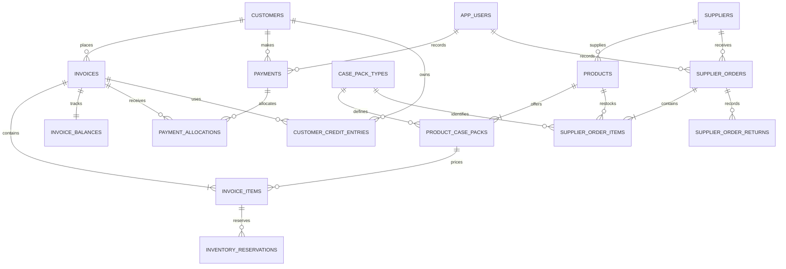

# BevDist data models and PostgreSQL schema plan

**Status:** planning document. The app still stores its working data in React state and seed objects. No database schema, migration, or backend behavior is implemented here. Backend work remains Markdown-only until the frontend is approved.

## Model map

The key relationship is `customer → invoice → invoice items and balance`. Each invoice remains its own sale and receivable. A customer's account screen groups open invoices for display, but never merges their records.

## Current frontend models

These describe the object shapes currently used by `mobileFrontend`; they are in-memory models, not PostgreSQL entities.

| Model | Current purpose and links |
|---|---|
| Customer | `id`, name, contact, address. `customerId` links invoices, balances, and payments. |
| Product | `id`, name, supplier name, enabled `casePackIds`, direct `casePrices`, and `stockByCasePack`. |
| Case pack | `id`, label, `unitsPerCase`. Standard packs are A/12, B/24, C/6; Mucho Red Horse uses 6- and 12-bottle packs. |
| Invoice (currently named `order`) | `id`, invoice/order numbers, `customerId` plus customer display snapshot, case-based items, totals, delivery status, lifecycle status, date. |
| Invoice item | Product and pack IDs plus display snapshots, cases, `stockQuantity`, bottle count per case, and direct case-price snapshot. Cases are the stock unit; quantities use 0.5 increments. |
| Invoice balance | One record per invoice: `orderId`, `customerId`, invoice number, original total, amount paid, remaining amount, due date, and status. |
| Payment transaction | Receipt information plus invoice allocation: `balanceId`, `orderId`, `customerId`, method, received amount, applied amount, excess, and date. The current UI may split one account payment into several invoice-linked rows. |
| Customer credit | Currently a map keyed by customer ID, holding the unspent excess payment. The database plan replaces this mutable map with a ledger. |
| Supplier order (currently `restockRecord`) | Supplier name, case-level product lines, four returned-case entries, product cost, returned credit, net cost, and date. |
| Inventory reservation | Currently represented by `reservedStock` on each product/case pack and inferred from pending invoice lines. The database should persist reservation history explicitly. |

The sample records now link invoice, customer, balance, payment, case pack, and reservation data. Seed product stock is a current demo snapshot; the old restock entry is historical and is not replayed into stock on app startup. Dashboard calculations use invoice totals and applied cash records. They exclude cancelled invoices, GCash, and excess payments from Cash Actual Sales.

## Proposed PostgreSQL tables

Use UUID primary keys, `timestamptz` audit dates, `date` for due dates and business-day reports, and `numeric` for money and case quantities. Store money as `numeric(12,2)` and cases as `numeric(10,2)`. Never use floating-point columns for either.

### `app_users`

One account is sufficient for the stated single-user deployment. Keep authentication records even with one user so that financial and inventory actions can be attributed.

| Column | Type and rule |
|---|---|
| `id` | UUID primary key |
| `username` | `text`, unique, not null |
| `password_hash` | `text`, not null; never store a password |
| `is_active` | `boolean`, not null, default true |
| `created_at`, `updated_at` | `timestamptz`, not null |

### `customers`

| Column | Type and rule |
|---|---|
| `id` | UUID primary key |
| `name` | `text`, not null |
| `contact` | `text`; preserve leading zeroes |
| `address` | `text` |
| `is_active` | `boolean`, not null, default true; prefer archiving to deletion |
| `created_at`, `updated_at` | `timestamptz`, not null |

Do not use a customer's name as a foreign key. Keep a name/contact snapshot on invoice headers or items only where it is needed to preserve the issued document after a profile edit.

### `suppliers`

`id uuid`, `name text UNIQUE NOT NULL`, `contact text`, `address text`, `is_active boolean`, and timestamps. Products and supplier orders reference this table instead of copying a supplier name as their relationship.

### `products`

`id uuid`, `supplier_id uuid REFERENCES suppliers`, `name text NOT NULL`, `is_active boolean NOT NULL DEFAULT true`, and timestamps. Archive products used by invoice or restock history; do not cascade-delete financial history.

### `case_pack_types`

Catalog for case definitions. Store stable codes instead of deciding pack type from a product name.

| Column | Type and rule |
|---|---|
| `code` | `text` primary key: `A`, `B`, `C`, `MUCHO_6`, `MUCHO_12` |
| `label` | `text`, not null |
| `units_per_case` | `integer`, positive; 12, 24, 6, 6, or 12 for the listed codes |
| `family` | `text`, such as `standard` or `mucho` |
| `is_active` | `boolean`, not null, default true |

### `product_case_packs`

One row for each case type configured for a product. This is the source of direct case prices and case-level inventory.

| Column | Type and rule |
|---|---|
| `product_id` | UUID, foreign key to `products` |
| `pack_code` | `text`, foreign key to `case_pack_types` |
| `case_price` | `numeric(12,2)`, not null, greater than zero; price per case, entered directly |
| `total_stock_cases` | `numeric(10,2)`, not null, default zero, nonnegative, half-case increments only |
| `reserved_stock_cases` | `numeric(10,2)`, not null, default zero; between zero and total stock, half-case increments only |
| `low_stock_threshold_cases` | `numeric(10,2)`, not null, default 15; configurable for this product and pack |
| `is_active` | `boolean`, not null, default true |

Primary key: `(product_id, pack_code)`. Available stock is derived as `total_stock_cases - reserved_stock_cases`; do not store a second editable available-stock value. The inventory screen and low-stock indicator must show each pack separately.

### `invoices`

Customer sale and live invoice header. Rename the frontend's customer `order` concept to `invoice` in the API/database; reserve “supplier order” for restocking.

| Column | Type and rule |
|---|---|
| `id` | UUID primary key |
| `invoice_number` | `text`, unique, not null |
| `customer_id` | UUID, foreign key to `customers`, not null |
| `status` | `text` check: `PENDING`, `COMPLETED`, `CANCELLED` |
| `delivery_status` | `text` check: `PENDING`, `DELIVERED` |
| `subtotal`, `total_amount` | `numeric(12,2)`, not null, nonnegative; update with invoice lines in one transaction |
| `customer_name_snapshot`, `customer_contact_snapshot`, `customer_address_snapshot` | `text`; preserve what was printed on the invoice |
| `created_at`, `updated_at`, `delivered_at`, `completed_at`, `cancelled_at` | `timestamptz` as applicable |
| `created_by` | UUID, foreign key to `app_users` |

`COMPLETED` requires delivered status and zero remaining balance. A cancelled invoice remains in history but is omitted from sales and receivables. A completed invoice is final; reject edits and duplicate completion.

### `invoice_items`

| Column | Type and rule |
|---|---|
| `id` | UUID primary key |
| `invoice_id` | UUID, foreign key to `invoices` |
| `product_id`, `pack_code` | Composite foreign key to `product_case_packs`; nullable only for a preserved legacy line |
| `product_name_snapshot`, `pack_label_snapshot` | `text`, not null; preserve historical invoice display |
| `units_per_case_snapshot` | `integer`, positive; historical display only, never used to convert stock |
| `quantity_cases` | `numeric(10,2)`, positive and in 0.5-case increments |
| `case_price_snapshot` | `numeric(12,2)`, not null, nonnegative; direct price per case at invoice creation |
| `line_total` | `numeric(12,2)` generated from quantity × case-price snapshot, rounded to two decimals |

Invoice `subtotal` is the sum of line totals. Editing a pending invoice updates its lines, total, balance, and reservations atomically. Once completed, the snapshots are immutable.

### `invoice_balances`

One-to-one with `invoices`. Keep every invoice balance distinct even when the customer account screen shows several balances together.

| Column | Type and rule |
|---|---|
| `invoice_id` | UUID primary key and foreign key to `invoices` |
| `total_amount` | `numeric(12,2)`, not null; synchronized with invoice total when a pending invoice changes |
| `amount_due` | `numeric(12,2)`, not null; equals total while active and becomes zero when cancelled |
| `amount_paid` | `numeric(12,2)`, not null, default zero; includes payment allocations and applied customer credit, and cannot exceed amount due |
| `remaining_balance` | Generated as `GREATEST(0, amount_due - amount_paid)` |
| `due_date` | `date`, not null |
| `updated_at` | `timestamptz`, not null |

On cancellation, preserve `total_amount`, set `amount_due` to zero, and keep paid amount zero; this makes the outstanding amount zero while retaining the original invoice total. Derive `PAID`, `UNPAID`, and `OVERDUE` from remaining amount and due date. Derive `CANCELLED` from the invoice. This avoids a second status that can disagree with invoice state.

### `inventory_reservations`

Persist each reservation as a history row linked to an invoice line. Set its status once to close it: reserve when a pending invoice is created, release on cancellation, and finalize on completion. An invoice edit closes old rows and inserts updated reservation rows.

| Column | Type and rule |
|---|---|
| `id` | UUID primary key |
| `invoice_item_id` | UUID, foreign key to `invoice_items` |
| `quantity_cases` | `numeric(10,2)`, positive and in half-case increments |
| `status` | `text` check: `ACTIVE`, `RELEASED`, `FINALIZED` |
| `created_at`, `closed_at` | `timestamptz` |
| `created_by` | UUID, foreign key to `app_users` |

Maintain `product_case_packs.reserved_stock_cases` in the same database transaction. Its value must equal the sum of active reservations for that product/pack. Lock affected pack rows before checking available stock so concurrent invoices cannot oversell.

### `payments` and `payment_allocations`

Represent one money receipt once, even when it settles multiple invoices. This is more reliable than duplicating one account receipt into several frontend transaction rows.

`payments`: `id uuid`, `customer_id uuid`, `method text` (`CASH`, `GCASH`, `BANK_TRANSFER`), `received_amount numeric(12,2) > 0`, `received_at timestamptz`, optional reference/note, and `created_by uuid`.

`payment_allocations`: `payment_id uuid`, `invoice_id uuid`, `amount_applied numeric(12,2) > 0`, and `allocation_order integer`. Use `(payment_id, invoice_id)` as the primary key. Allocation amounts cannot exceed each invoice's remaining amount, and their sum cannot exceed the receipt. The service transaction locks open invoices and allocates oldest invoice first.

Compute excess as `received_amount - SUM(payment_allocations.amount_applied)`. Record excess as customer credit; never add it to invoice sales. GCash remains in payment history and its dedicated report.

### `customer_credit_entries`

Append-only ledger replacing the frontend's `customerCredits` object.

| Column | Type and rule |
|---|---|
| `id` | UUID primary key |
| `customer_id` | UUID, foreign key to `customers` |
| `source_payment_id` | UUID, foreign key to `payments`, nullable for approved adjustments |
| `invoice_id` | UUID, foreign key to `invoices`, nullable for issued credit and required for application |
| `entry_type` | `text` check: `ISSUED`, `APPLIED`, `REFUNDED`, `ADJUSTED` |
| `amount` | `numeric(12,2)`, positive |
| `created_at`, `created_by` | Audit fields |

Available credit is issued credit less applied/refunded credit. Apply credit to the new invoice in the same transaction that creates the invoice and its balance; increase `invoice_balances.amount_paid` by the credit applied. Credit applied is not a new cash receipt; keep it separate from cash payment allocations and Cash Actual Sales.

### `supplier_order_returns` and returned-case catalog

Keep the four supplier-return types separate from sales case packs. Store their agreed names and credits in a `returned_case_types` reference table, and snapshot both on each return line.

`returned_case_types`: `code text PRIMARY KEY`, `label text UNIQUE`, `credit_per_case numeric(12,2) > 0`, `is_active boolean`.

`supplier_order_returns`: `id uuid`, `supplier_order_id uuid`, `return_type_code text`, `label_snapshot text`, `quantity numeric(10,2)`, `credit_per_case_snapshot numeric(12,2)`, and generated `credit_total`. Use nonnegative quantities and half-case increments if returns allow half cases.

The prototype currently has four placeholder return types and credits. Confirm their real names and credit values with the client before seeding production data.

### `supplier_orders` and `supplier_order_items`

`supplier_orders`: UUID ID, unique supplier-order number, supplier FK, received date/time, product cost total, returned credit total, net cost, notes, creator, and creation timestamp.

`supplier_order_items`: UUID ID, supplier-order FK, product/pack composite FK, product and pack label snapshots, cases received, direct cost per case, and generated line total. Each saved supplier order increments stock for its exact product/pack in the same transaction; returned-case credits reduce supplier cost and never reduce sales.

### `inventory_movements` (recommended audit table)

Record stock changes that are not fully explained by the current on-hand snapshot: supplier receipt, completed invoice deduction, manual inventory edit, or correction. Include product/pack, signed case delta, source table and ID, reason, actor, and timestamp. Write the movement and update `total_stock_cases` in one transaction. Do not use this table as a substitute for the invoice reservation lifecycle.

## Dashboard definitions

| Dashboard number | Definition |
|---|---|
| Total Expected Sales | Sum invoice `total_amount` for every non-cancelled invoice, including pending, unpaid, partial, and completed invoices. Count each invoice once. |
| Actual Sales | Sum cash payment allocations applied to non-cancelled invoices. Exclude unapplied excess/customer credit and GCash. |
| GCash report | Sum GCash payment receipts or allocations for the selected date range; show received and applied separately if useful. |
| Outstanding Invoices | Count non-cancelled invoices whose remaining balance is above zero. |
| Outstanding Balances | Sum remaining balances for non-cancelled invoices. |
| Completed Orders | Count invoices that are delivered and fully paid. |
| Daily/Monthly Cash Sales | Group cash allocations by payment date, not invoice creation date; exclude cancelled invoices and excess. |
| Case Types to Restock | Count each product/case pack whose available cases are at or below its configured low-stock threshold, including zero stock. |

The demo seed currently reconciles to **₱2,784 expected sales**, **₱2,156 cash applied**, **₱628 outstanding**, two completed invoices, and two open invoices. Its cancelled ₱336 invoice is excluded. The ₱68 excess payment remains customer credit and is not counted as sales.

## Required database transactions

1. **Create or edit pending invoice:** lock affected product/pack rows; validate half-case quantities and available stock; update invoice lines and totals; update balance; adjust active reservations; apply customer credit if selected; commit together.
2. **Record customer payment:** lock the customer's open invoice balances ordered oldest first; insert one payment; insert one allocation per invoice; update amounts paid; issue any excess as customer credit; mark an invoice completed only if already delivered and fully paid; commit together.
3. **Deliver, complete, or cancel:** verify lifecycle and payment conditions; on completion deduct reserved cases from physical stock and close reservations; on cancellation release reservations and set remaining due to zero; preserve all invoice and payment history.
4. **Save supplier order:** validate supplier, pack, quantity and costs; insert order, product lines, return credits, and stock movements; increment only the received product/pack quantities; commit together.
5. **Edit inventory:** validate each pack independently; reject stock below active reservations; write an adjustment record and update stock atomically.

## Migration and verification checklist

- [ ] Confirm the four returned-case names and credit values with the client.
- [ ] Confirm the per-pack low-stock threshold; the current prototype uses 15 available cases.
- [ ] Create lookup tables and users/customers/suppliers/products before transactional tables.
- [ ] Seed case-pack catalog and product-to-pack associations explicitly; never infer pack type from the product name.
- [ ] Import invoices and item snapshots, then balances, payments/allocations, customer-credit entries, supplier orders, returns, and reservations.
- [ ] Treat current product stock as opening inventory when seeding movements; do not replay historical demo restocks a second time.
- [ ] Reconcile invoice totals to line totals; balance paid plus remaining to invoice total; receipt amount to applied allocations plus excess; reservations to active pending invoice quantities; and physical stock to movement history.
- [ ] Verify dashboard totals against SQL queries and the frontend seed expectations above.
- [ ] Keep backend implementation and migrations in Markdown planning until frontend approval, per project direction.
